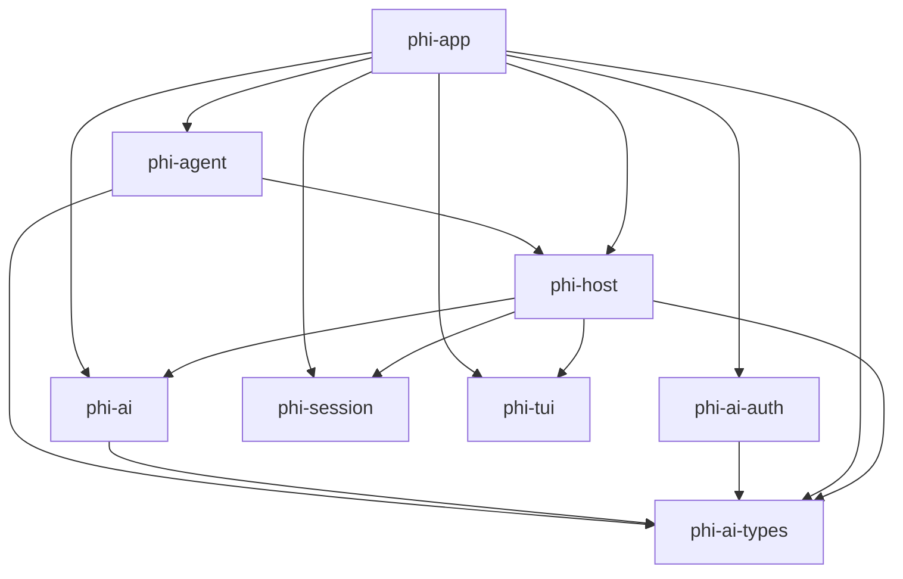

<!-- GENERATED FILE — do not edit by hand.
     Regenerate: scripts/gen-arch.sh
     Freshness is enforced by `nix flake check` (checks.arch-fresh). -->

# Architecture map (generated)

Structural map of the workspace, extracted from the code. For rationale,
invariants, and dataflow, see DESIGN.md.

## Crate dependency graph

Internal (workspace-local) dependencies only. `A --> B` means A depends on B.



## Crates

| Crate | Description |
|-------|-------------|
| `phi-agent` | packages/agent port: Lua-authored agent policy pack |
| `phi-ai` | packages/ai port: transport (HTTP/SSE/retry/cancellation), protocols, registry |
| `phi-ai-auth` | packages/ai oauth port: PKCE engine, flows as data, provider registry |
| `phi-ai-types` | packages/ai type vocabulary: models, messages, content, usage, stream events |
| `phi-app` | _no description in Cargo.toml_ |
| `phi-host` | Lua extension host: coroutine async seam, event bus, watchdog |
| `phi-session` | Session manager: append-only JSONL session trees (port of core/session-manager.ts) |
| `phi-tui` | _no description in Cargo.toml_ |

## Module structure

Per-crate module/item trees (`cargo modules structure`). Functions are
omitted; types, traits, and module boundaries are the architecture.

### `phi-agent`

```
