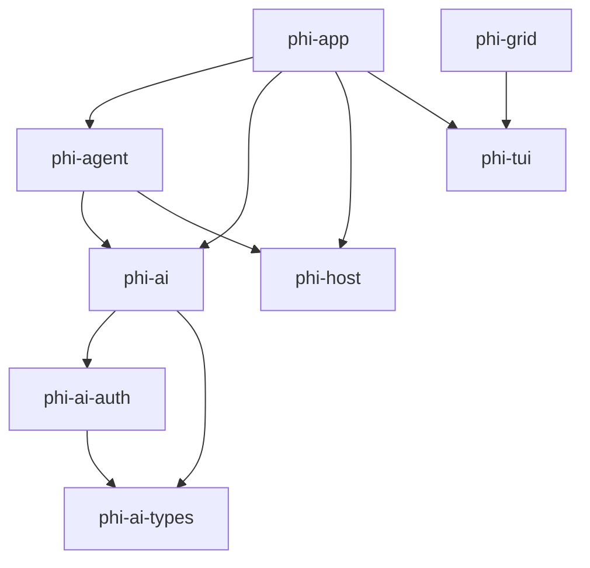

<!-- GENERATED FILE — do not edit by hand.
     Regenerate: scripts/gen-arch.sh
     Freshness is enforced by `nix flake check` (checks.arch-fresh). -->

# Architecture map (generated)

Structural map of the workspace, extracted from the code. For rationale,
invariants, and dataflow, see DESIGN.md.

## Crate dependency graph

Internal (workspace-local) dependencies only. `A --> B` means A depends on B.



## Crates

| Crate | Description |
|-------|-------------|
| `phi-agent` | _no description in Cargo.toml_ |
| `phi-ai` | _no description in Cargo.toml_ |
| `phi-ai-auth` | _no description in Cargo.toml_ |
| `phi-ai-types` | _no description in Cargo.toml_ |
| `phi-app` | _no description in Cargo.toml_ |
| `phi-grid` | _no description in Cargo.toml_ |
| `phi-host` | _no description in Cargo.toml_ |
| `phi-tui` | _no description in Cargo.toml_ |

## Module structure

Per-crate module/item trees (`cargo modules structure`). Functions are
omitted; types, traits, and module boundaries are the architecture.

### `phi-agent`

```

crate phi_agent
├── enum AgentEvent: pub
├── struct RunOutcome: pub
├── type SteeringQueue: pub
├── type StreamFn: pub
├── mod prompt: pub
├── mod tools: pub
│   ├── mod bash: pub(self)
│   │   └── enum Ending: pub(self)
│   ├── mod edit: pub(self)
│   ├── mod read: pub(self)
│   └── mod write: pub(self)
└── mod truncate: pub(crate)
    └── struct Truncation: pub
```

### `phi-ai`

```

crate phi_ai
├── mod lm: pub
├── mod overflow: pub
├── mod providers: pub
│   ├── mod anthropic: pub
│   │   ├── struct AnthropicProvider: pub
│   │   ├── mod request: pub(self)
│   │   └── mod response: pub(self)
│   │       ├── enum BlockDelta: pub(self)
│   │       ├── struct ContentBlockDeltaEvent: pub(self)
│   │       ├── enum ContentBlockStart: pub(self)
│   │       ├── struct ContentBlockStartEvent: pub(self)
│   │       ├── struct ContentBlockStopEvent: pub(self)
│   │       ├── struct ErrorBody: pub(self)
│   │       ├── struct ErrorEvent: pub(self)
│   │       ├── struct MessageDeltaBody: pub(self)
│   │       ├── struct MessageDeltaEvent: pub(self)
│   │       ├── struct MessageStartBody: pub(self)
│   │       ├── struct MessageStartEvent: pub(self)
│   │       ├── struct Parser: pub(super)
│   │       ├── struct StopDetails: pub(self)
│   │       ├── struct ToolBuffer: pub(self)
│   │       ├── struct UsageBody: pub(self)
│   │       └── struct UsageDelta: pub(self)
│   ├── mod cursor: pub
│   │   ├── struct CursorProvider: pub
│   │   ├── mod auth: pub(self)
│   │   │   ├── struct CursorApiKeyExchangeResponse: pub(self)
│   │   │   ├── struct CursorAuthFileData: pub(self)
│   │   │   ├── struct CursorDirectTokens: pub
│   │   │   ├── struct CursorRefreshRequest: pub(self)
│   │   │   ├── struct CursorRefreshResponse: pub(self)
│   │   │   ├── struct CursorRefreshResponseOwned: pub(self)
│   │   │   └── struct JwtClaims: pub(self)
│   │   ├── mod proto: pub(self)
│   │   │   ├── enum FieldValue: pub(self)
│   │   │   ├── struct FrameResult: pub
│   │   │   └── struct ProtobufField: pub(self)
│   │   └── mod think_router: pub(self)
│   │       └── struct ThinkRouter: pub
│   ├── mod openai_completions: pub
│   │   ├── struct OpenAiCompletionsProvider: pub
│   │   ├── mod request: pub(self)
│   │   └── mod response: pub(self)
│   │       ├── struct Parser: pub(super)
│   │       └── struct ToolBuffer: pub(self)
│   ├── mod openai_responses: pub
│   │   ├── struct OpenAiResponsesProvider: pub
│   │   ├── mod request: pub(self)
│   │   └── mod response: pub(self)
│   │       ├── struct Parser: pub(super)
│   │       └── struct ToolBuffer: pub(self)
│   ├── mod retry: pub(self)
│   └── mod sse: pub(self)
│       ├── struct CappedSse: pub(crate)
│       ├── enum CappedSseError: pub(crate)
│       ├── struct SseEvent: pub(crate)
│       └── trait SseHandler: pub(crate)
├── mod registry: pub
│   ├── trait ApiProvider: pub
│   └── struct Registry: pub
├── mod stream: pub
│   ├── struct Accumulator: pub
│   ├── enum AssistantEvent: pub
│   ├── struct AssistantEventStream: pub
│   └── struct EventSink: pub
└── mod types: pub
```

### `phi-ai-auth`

```

crate phi_ai_auth
└── mod auth: pub(crate)
    ├── mod anthropic: pub(self)
    ├── mod callback_server: pub(self)
    │   └── struct CallbackServer: pub
    ├── mod callbacks: pub(self)
    │   ├── trait LoginCallbacks: pub
    │   ├── enum LoginMethod: pub
    │   └── struct PrintCallbacks: pub
    ├── mod codex: pub(self)
    ├── mod cursor: pub(self)
    │   ├── struct CursorAuthParams: pub(self)
    │   └── struct PollResponse: pub(self)
    ├── mod device_code: pub(self)
    │   └── enum PollOutcome: pub
    ├── mod error: pub(self)
    │   └── enum AuthError: pub
    ├── mod login: pub(self)
    ├── mod pkce: pub(self)
    │   └── struct Pkce: pub
    ├── mod storage: pub(self)
    │   ├── type AuthData: pub(self)
    │   └── struct AuthStorage: pub
    ├── mod types: pub(self)
    │   ├── enum AuthCredential: pub
    │   ├── struct OAuthCredentials: pub
    │   └── enum OAuthProviderId: pub
    └── mod util: pub(self)
```

### `phi-ai-types`

```

crate phi_ai_types
├── mod lm: pub
│   ├── struct ChatMessage: pub
│   ├── struct Completion: pub
│   ├── enum ContextPayload: pub
│   ├── type DeltaSink: pub
│   ├── trait LanguageModel: pub
│   ├── enum Role: pub
│   ├── type ThinkingSink: pub
│   ├── enum ToolCallEvent: pub
│   ├── type ToolCallSink: pub
│   └── struct UsageBreakdown: pub
└── mod types: pub
    ├── enum Api: pub
    ├── enum AssistantContent: pub
    ├── struct AssistantMessage: pub
    ├── enum Auth: pub
    ├── struct Context: pub
    ├── struct Cost: pub
    ├── struct CostRates: pub
    ├── enum Message: pub
    ├── enum Modality: pub
    ├── struct Model: pub
    ├── enum StopReason: pub
    ├── struct StreamOptions: pub
    ├── enum ThinkingLevel: pub
    ├── struct ToolCall: pub
    ├── struct ToolDefinition: pub
    ├── struct ToolResultMessage: pub
    ├── struct Usage: pub
    └── struct UserMessage: pub
```

### `phi-app`

```

crate phi
├── mod agent: pub(crate)
│   ├── struct Renderer: pub(self)
│   └── struct RunSpec: pub
├── mod chat: pub(crate)
│   ├── enum Block: pub(self)
│   ├── struct Chat: pub(self)
│   ├── struct ChatSpec: pub
│   ├── struct ChatState: pub(self)
│   ├── enum Flow: pub(self)
│   ├── struct NoticeCallbacks: pub(self)
│   └── enum UiMsg: pub(self)
├── mod cli: pub(crate)
│   └── struct Args: pub
├── mod extensions: pub(crate)
├── mod format: pub(crate)
├── mod settings: pub(crate)
│   └── struct Settings: pub
└── mod transcript: pub(crate)
```

### `phi-grid`

```

crate phi_grid
├── mod ansi: pub
│   ├── struct AnsiCodegen: pub(self)
│   ├── struct AnsiRenderer: pub
│   ├── struct AnsiStyle: pub(self)
│   ├── struct HardwareCursor: pub
│   ├── enum Patch: pub(self)
│   ├── struct PatchOptimizer: pub(self)
│   └── enum ScrollDirective: pub(self)
├── mod cell_surface: pub
│   └── struct CellSurface: pub
├── mod color: pub
│   └── struct Color: pub
├── mod damage: pub
│   ├── struct DirtyRegion: pub
│   └── struct Rect: pub
├── mod layout: pub
│   ├── struct CellLayout: pub
│   └── struct CellRect: pub
├── mod packed: pub
│   ├── struct PackedCell: pub
│   ├── struct PackedStyle: pub
│   ├── struct PackedText: pub
│   └── struct StringInterner: pub
├── mod selection: pub
│   ├── struct SelectionPoint: pub
│   ├── struct SelectionRange: pub
│   └── struct TerminalSelection: pub
└── mod theme: pub
    └── struct GeneratedTheme: pub
```

### `phi-host`

```

crate phi_host
├── struct CommandInfo: pub
├── struct Dispatch: pub
├── struct Host: pub
├── struct HostConfig: pub
├── type NativeToolFn: pub
├── struct ToolInfo: pub
├── struct ToolOutput: pub
├── mod convert: pub(crate)
├── mod discovery: pub(crate)
├── mod globals: pub(crate)
│   └── struct Meta: pub(crate)
├── mod thread: pub(crate)
│   ├── enum LuaMsg: pub(crate)
│   └── struct RawOutcome: pub
└── mod trust: pub(crate)
    ├── enum TrustDecision: pub
    └── struct TrustStore: pub
```

### `phi-tui`

```

crate phi_tui
├── mod cells: pub
├── mod clock: pub
│   └── struct AnimationClock: pub
├── mod color_cap: pub
│   └── enum ColorCapability: pub
├── mod editor: pub
│   ├── struct Editor: pub
│   └── enum EditorAction: pub
├── mod fuzzy: pub
├── mod keymap: pub
│   ├── trait BindingEntry: pub
│   ├── struct BindingSpec: pub
│   ├── struct KeyModifiers: pub
│   ├── struct KeyStroke: pub
│   ├── enum KeyToken: pub
│   ├── struct Keymap: pub
│   ├── enum KeymapMatch: pub
│   └── enum NamedKeyToken: pub
├── mod markdown: pub #[cfg(feature = "markdown")]
│   ├── mod constants: pub(self)
│   │   ├── struct MarkdownPalette: pub
│   │   └── struct SyntaxColors: pub(self)
│   ├── mod highlight: pub(self)
│   │   └── struct HighlightCache: pub(self)
│   ├── mod output: pub(self)
│   └── mod render: pub(self)
│       ├── struct ListLevel: pub(super)
│       ├── struct Renderer: pub(super)
│       └── struct Style: pub(super)
├── mod palette: pub
│   ├── struct Parsed: pub(self)
│   ├── struct Rgb: pub
│   └── struct TerminalColors: pub
├── mod selector: pub
│   ├── struct Selector: pub
│   ├── struct SelectorItem: pub
│   ├── enum SelectorOutcome: pub
│   └── struct SelectorStyle: pub
├── mod spinner: pub
│   └── struct Spinner: pub
├── mod style: pub
├── mod symbols: pub
├── mod terminal: pub
│   ├── struct AnsiState: pub(self)
│   ├── struct LiveCursor: pub
│   ├── struct RawModeGuard: pub
│   ├── struct Terminal: pub
│   ├── type WrapMarks: pub(self)
│   ├── type WrappedAnsi: pub(self)
│   └── struct Wrapper: pub(self)
└── mod theme: pub
    ├── enum Mode: pub
    └── struct Theme: pub
```
