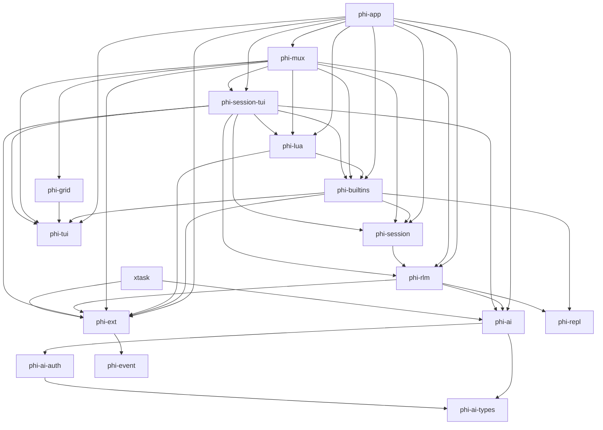

<!-- GENERATED FILE — do not edit by hand.
     Regenerate: scripts/gen-arch.sh
     Freshness is enforced by `nix flake check` (checks.arch-fresh). -->

# Architecture map (generated)

Structural map of the workspace, extracted from the code. For rationale,
invariants, and dataflow, see DESIGN.md / PLAN.md.

## Crate dependency graph

Internal (workspace-local) dependencies only. `A --> B` means A depends on B.



## Crates

| Crate | Description |
|-------|-------------|
| `phi-ai` | _no description in Cargo.toml_ |
| `phi-ai-auth` | _no description in Cargo.toml_ |
| `phi-ai-types` | _no description in Cargo.toml_ |
| `phi-app` | _no description in Cargo.toml_ |
| `phi-builtins` | _no description in Cargo.toml_ |
| `phi-event` | _no description in Cargo.toml_ |
| `phi-ext` | _no description in Cargo.toml_ |
| `phi-grid` | _no description in Cargo.toml_ |
| `phi-lua` | _no description in Cargo.toml_ |
| `phi-mux` | _no description in Cargo.toml_ |
| `phi-repl` | _no description in Cargo.toml_ |
| `phi-rlm` | _no description in Cargo.toml_ |
| `phi-session` | _no description in Cargo.toml_ |
| `phi-session-tui` | _no description in Cargo.toml_ |
| `phi-tui` | _no description in Cargo.toml_ |
| `xtask` | _no description in Cargo.toml_ |

## Module structure

Per-crate module/item trees (`cargo modules structure`). Functions are
omitted; types, traits, and module boundaries are the architecture.

### `phi-ai`

```

crate phi_ai
├── mod lm: pub
├── mod overflow: pub
├── mod providers: pub
│   ├── mod anthropic: pub
│   │   ├── struct AnthropicProvider: pub
│   │   ├── mod request: pub(self)
│   │   └── mod response: pub(self)
│   │       ├── enum BlockDelta: pub(self)
│   │       ├── struct ContentBlockDeltaEvent: pub(self)
│   │       ├── enum ContentBlockStart: pub(self)
│   │       ├── struct ContentBlockStartEvent: pub(self)
│   │       ├── struct ContentBlockStopEvent: pub(self)
│   │       ├── struct ErrorBody: pub(self)
│   │       ├── struct ErrorEvent: pub(self)
│   │       ├── struct MessageDeltaBody: pub(self)
│   │       ├── struct MessageDeltaEvent: pub(self)
│   │       ├── struct MessageStartBody: pub(self)
│   │       ├── struct MessageStartEvent: pub(self)
│   │       ├── struct Parser: pub(super)
│   │       ├── struct StopDetails: pub(self)
│   │       ├── struct ToolBuffer: pub(self)
│   │       ├── struct UsageBody: pub(self)
│   │       └── struct UsageDelta: pub(self)
│   ├── mod cursor: pub
│   │   ├── struct CursorProvider: pub
│   │   ├── mod auth: pub(self)
│   │   │   ├── struct CursorApiKeyExchangeResponse: pub(self)
│   │   │   ├── struct CursorAuthFileData: pub(self)
│   │   │   ├── struct CursorDirectTokens: pub
│   │   │   ├── struct CursorRefreshRequest: pub(self)
│   │   │   ├── struct CursorRefreshResponse: pub(self)
│   │   │   ├── struct CursorRefreshResponseOwned: pub(self)
│   │   │   └── struct JwtClaims: pub(self)
│   │   ├── mod proto: pub(self)
│   │   │   ├── enum FieldValue: pub(self)
│   │   │   ├── struct FrameResult: pub
│   │   │   └── struct ProtobufField: pub(self)
│   │   └── mod think_router: pub(self)
│   │       └── struct ThinkRouter: pub
│   ├── mod openai_completions: pub
│   │   ├── struct OpenAiCompletionsProvider: pub
│   │   ├── mod request: pub(self)
│   │   └── mod response: pub(self)
│   │       ├── struct Parser: pub(super)
│   │       └── struct ToolBuffer: pub(self)
│   ├── mod openai_responses: pub
│   │   ├── struct OpenAiResponsesProvider: pub
│   │   ├── mod request: pub(self)
│   │   └── mod response: pub(self)
│   │       ├── struct Parser: pub(super)
│   │       └── struct ToolBuffer: pub(self)
│   ├── mod retry: pub(self)
│   └── mod sse: pub(self)
│       ├── struct CappedSse: pub(crate)
│       ├── enum CappedSseError: pub(crate)
│       ├── struct SseEvent: pub(crate)
│       └── trait SseHandler: pub(crate)
├── mod registry: pub
│   ├── trait ApiProvider: pub
│   └── struct Registry: pub
├── mod stream: pub
│   ├── struct Accumulator: pub
│   ├── enum AssistantEvent: pub
│   ├── struct AssistantEventStream: pub
│   └── struct EventSink: pub
└── mod types: pub
```

### `phi-ai-auth`

```

crate phi_ai_auth
└── mod auth: pub(crate)
    ├── mod anthropic: pub(self)
    ├── mod callback_server: pub(self)
    │   └── struct CallbackServer: pub
    ├── mod callbacks: pub(self)
    │   ├── trait LoginCallbacks: pub
    │   ├── enum LoginMethod: pub
    │   └── struct PrintCallbacks: pub
    ├── mod codex: pub(self)
    ├── mod cursor: pub(self)
    │   ├── struct CursorAuthParams: pub(self)
    │   └── struct PollResponse: pub(self)
    ├── mod device_code: pub(self)
    │   └── enum PollOutcome: pub
    ├── mod error: pub(self)
    │   └── enum AuthError: pub
    ├── mod login: pub(self)
    ├── mod pkce: pub(self)
    │   └── struct Pkce: pub
    ├── mod storage: pub(self)
    │   ├── type AuthData: pub(self)
    │   └── struct AuthStorage: pub
    ├── mod types: pub(self)
    │   ├── enum AuthCredential: pub
    │   ├── struct OAuthCredentials: pub
    │   └── enum OAuthProviderId: pub
    └── mod util: pub(self)
```

### `phi-ai-types`

```

crate phi_ai_types
├── mod lm: pub
│   ├── struct ChatMessage: pub
│   ├── struct Completion: pub
│   ├── enum ContextPayload: pub
│   ├── type DeltaSink: pub
│   ├── trait LanguageModel: pub
│   ├── enum Role: pub
│   ├── type ThinkingSink: pub
│   ├── enum ToolCallEvent: pub
│   ├── type ToolCallSink: pub
│   └── struct UsageBreakdown: pub
└── mod types: pub
    ├── enum Api: pub
    ├── enum AssistantContent: pub
    ├── struct AssistantMessage: pub
    ├── enum Auth: pub
    ├── struct Context: pub
    ├── struct Cost: pub
    ├── struct CostRates: pub
    ├── enum Message: pub
    ├── enum Modality: pub
    ├── struct Model: pub
    ├── enum StopReason: pub
    ├── struct StreamOptions: pub
    ├── enum ThinkingLevel: pub
    ├── struct ToolCall: pub
    ├── struct ToolDefinition: pub
    ├── struct ToolResultMessage: pub
    ├── struct Usage: pub
    └── struct UserMessage: pub
```

### `phi-app`

```

crate phi
├── mod cli: pub(crate)
│   └── struct Args: pub
├── mod event_print: pub(crate)
│   └── struct PendingTool: pub(self)
├── mod format: pub(crate)
├── mod oneshot: pub(crate)
├── mod render: pub(crate)
└── mod tool_view: pub(crate)
    └── struct ToolEcho: pub(crate)
```

### `phi-builtins`

```

crate phi_builtins
├── mod catalog: pub #[cfg(feature = "builtins")]
│   └── struct CatalogExtension: pub
├── mod defaults: pub #[cfg(feature = "builtins")]
├── mod mcp: pub #[cfg(feature = "builtins")]
│   ├── struct McpExtension: pub
│   ├── mod client: pub(self)
│   │   ├── struct HttpTransport: pub(self)
│   │   ├── struct McpClient: pub
│   │   ├── struct McpTool: pub
│   │   ├── struct StdioTransport: pub(self)
│   │   ├── enum Transport: pub(self)
│   │   └── enum TransportConfig: pub
│   └── mod expand: pub(self)
├── mod overlays: pub #[cfg(feature = "builtins")]
│   ├── struct DefaultOverlayExtension: pub
│   ├── mod archive: pub(self)
│   │   └── struct ArchiveOverlayState: pub(self)
│   ├── mod dialog: pub(self)
│   ├── mod model: pub(self)
│   │   └── struct ModelOverlayState: pub(self)
│   └── mod usage: pub(self)
│       └── struct UsageOverlayState: pub(self)
├── mod prelude: pub
└── mod visual: pub #[cfg(feature = "builtins")]
    └── struct DefaultVisualExtension: pub
```

### `phi-event`

```

crate phi_event
├── type ContextualEventHandler: pub
├── type EventHandler: pub
├── struct EventHandlerRegistration: pub
├── enum EventKind: pub
├── enum EventPayload: pub
├── enum EventReturn: pub
├── struct ExtensionContextRef: pub
├── enum ExtensionMode: pub
├── enum InputActionKind: pub
└── struct LifecycleEvent: pub
```

### `phi-ext`

```

crate phi_ext
├── mod animation_spec: pub
│   ├── enum ExpressionSelection: pub
│   ├── struct SpinnerSpec: pub
│   ├── struct TextEffectSpec: pub
│   └── struct ThinkingExpressionSpec: pub
├── mod builder: pub
│   └── struct RuntimeBuilder: pub
├── mod chrome_spec: pub
│   ├── enum ChromeContainer: pub
│   ├── struct ChromeSpec: pub
│   ├── enum PendingIndicator: pub
│   ├── enum StatusEffect: pub
│   └── enum StatusIndicator: pub
├── mod command: pub
│   ├── type ArgCompletionFn: pub
│   ├── enum CommandContext: pub
│   ├── type CommandHandler: pub
│   ├── struct CommandInfo: pub
│   ├── struct CommandInvocation: pub
│   ├── struct CommandOutput: pub
│   ├── struct CommandSpec: pub
│   ├── enum PickerKind: pub
│   └── enum UiAction: pub
├── mod draw_context: pub
│   ├── trait DrawContext: pub
│   ├── struct DrawRect: pub
│   ├── struct DrawSize: pub
│   ├── struct OverlayKey: pub
│   ├── enum OverlayKeyCode: pub
│   ├── struct OverlayKeyModifiers: pub
│   └── struct OverlayPalette: pub
├── mod event: pub
├── mod flag: pub
│   ├── struct FlagSpec: pub
│   └── enum FlagType: pub
├── mod host: pub
│   └── struct RegistryHost: pub(crate)
├── mod manifest: pub
│   └── struct ExtensionManifest: pub
├── mod message_renderer: pub
│   └── struct MessageRendererSpec: pub
├── mod overlay_spec: pub
│   ├── enum HelpEntry: pub
│   ├── struct HelpPayload: pub
│   ├── struct ModelPickerPayload: pub
│   ├── type OverlayInitFn: pub
│   ├── type OverlayKeyFn: pub
│   ├── enum OverlayOutcome: pub
│   ├── type OverlayPayload: pub
│   ├── type OverlayRenderFn: pub
│   ├── type OverlayRespondFn: pub(self)
│   ├── struct OverlayResponder: pub
│   ├── type OverlayResponse: pub
│   ├── type OverlayScrollFn: pub
│   ├── struct OverlaySpec: pub
│   └── type OverlayState: pub
├── mod provider: pub
│   ├── struct ProviderConfig: pub
│   ├── struct ProviderModelConfig: pub
│   └── struct ProviderModelCost: pub
├── mod runtime: pub
│   ├── struct AppRuntime: pub
│   ├── struct DiscoveredResources: pub
│   ├── enum ForkDecision: pub
│   ├── struct ProjectTrustDecision: pub
│   ├── enum ToolInterception: pub
│   └── enum TreeDecision: pub
├── mod shortcut: pub
│   └── struct ShortcutSpec: pub
├── mod snapshot: pub
│   ├── struct CommandSummary: pub
│   ├── struct EventHandlerSummary: pub
│   ├── struct FlagSummary: pub
│   ├── struct OverlaySummary: pub
│   ├── struct RuntimeSnapshot: pub
│   ├── struct ShortcutSummary: pub
│   ├── struct SpinnerSummary: pub
│   ├── struct TextEffectSummary: pub
│   ├── struct ThemeSummary: pub
│   ├── struct ThinkingExpressionSummary: pub
│   └── struct ToolSummary: pub
├── mod style_spec: pub
│   └── struct StyleSpec: pub
├── mod theme_spec: pub
│   ├── struct TerminalColorsProbe: pub
│   └── struct ThemeSpec: pub
├── mod tool: pub
│   ├── enum ToolDispatch: pub
│   ├── enum ToolExposure: pub
│   ├── type ToolHandler: pub
│   ├── struct ToolInvocation: pub
│   ├── struct ToolOutput: pub
│   ├── struct ToolParam: pub
│   └── struct ToolSpec: pub
├── mod tool_render: pub
│   ├── struct AnchorArg: pub
│   ├── enum AnchorStyle: pub
│   ├── enum ResultLang: pub
│   ├── enum ToolBody: pub
│   ├── enum ToolRenderCategory: pub
│   ├── struct ToolRenderIndex: pub
│   └── struct ToolRenderSpec: pub
├── mod traits: pub
│   ├── enum AnimationSpec: pub
│   ├── trait Extension: pub
│   └── trait ExtensionHost: pub
├── mod ui: pub
│   ├── enum UiAskOutcome: pub
│   ├── struct UiHandle: pub
│   ├── struct UiPrompt: pub
│   ├── struct UiPromptOption: pub
│   └── struct UiPromptRequest: pub
└── mod visual: pub
    ├── struct Rgb: pub
    ├── struct StyledSpan: pub
    └── struct StyledText: pub
```

### `phi-grid`

```

crate phi_grid
├── mod ansi: pub
│   ├── struct AnsiCodegen: pub(self)
│   ├── struct AnsiRenderer: pub
│   ├── struct AnsiStyle: pub(self)
│   ├── struct HardwareCursor: pub
│   ├── enum Patch: pub(self)
│   ├── struct PatchOptimizer: pub(self)
│   └── enum ScrollDirective: pub(self)
├── mod cell_surface: pub
│   └── struct CellSurface: pub
├── mod color: pub
│   └── struct Color: pub
├── mod damage: pub
│   └── struct DirtyRegion: pub
├── mod layout: pub
│   ├── struct CellLayout: pub
│   └── struct CellRect: pub
├── mod packed: pub
│   ├── struct PackedCell: pub
│   ├── struct PackedStyle: pub
│   ├── struct PackedText: pub
│   └── struct StringInterner: pub
├── mod selection: pub
│   ├── struct SelectionPoint: pub
│   ├── struct SelectionRange: pub
│   └── struct TerminalSelection: pub
└── mod theme: pub
    └── struct GeneratedTheme: pub
```

### `phi-lua`

```

crate phi_lua
├── mod config: pub
├── mod discovery: pub
├── mod extension: pub
│   ├── struct LuaExtension: pub
│   ├── mod bridge: pub(self)
│   ├── mod convert: pub(self)
│   ├── mod event_return: pub(self)
│   ├── mod globals: pub(self)
│   ├── mod overlay: pub(self)
│   │   ├── struct LuaOverlayFns: pub(super)
│   │   └── struct LuaOverlayInstance: pub(self)
│   └── mod thread: pub(self)
│       └── enum LuaMsg: pub
└── mod loader: pub
```

### `phi-mux`

```

crate phi_mux
├── mod app: pub
│   ├── struct ActiveExtensionOverlay: pub(crate)
│   ├── enum HostIo: pub(crate)
│   ├── enum InputSource: pub(crate)
│   ├── struct MuxApp: pub(self)
│   ├── struct MuxReceivers: pub(crate)
│   ├── enum RenderSink: pub(crate)
│   ├── struct WorkspaceSetup: pub(self)
│   ├── mod commands: pub(self)
│   ├── mod input: pub(self)
│   ├── mod rendering: pub(self)
│   ├── mod session: pub(self)
│   └── mod view: pub(self)
│       └── struct MuxView: pub(crate)
├── mod clipboard: pub
│   └── struct MuxClipboard: pub
├── mod command_line: pub
│   ├── enum CommandLineEvent: pub
│   └── struct CommandLineState: pub
├── mod driver: pub
│   ├── struct MuxChannels: pub
│   ├── struct ParserWriter: pub
│   ├── struct SessionHandle: pub
│   └── type SessionKey: pub
├── mod keys: pub
│   └── mod keymap: pub(self)
│       ├── type ActionSpec: pub
│       └── enum AppAction: pub
├── mod persisted: pub
│   ├── struct PersistedState: pub
│   └── enum SaveCommand: pub(self)
├── mod remote: pub
│   ├── mod client: pub
│   ├── mod daemon: pub
│   │   └── struct DaemonLock: pub
│   ├── mod protocol: pub
│   │   ├── enum ClientMsg: pub
│   │   └── enum ServerMsg: pub
│   └── mod server: pub
│       ├── struct AttachInfo: pub
│       ├── struct ClientRegistry: pub
│       ├── struct Inner: pub(self)
│       ├── struct RemoteClient: pub(self)
│       ├── enum RemoteEvent: pub
│       └── struct RemoveOnDrop: pub(self)
├── mod status: pub
│   └── enum SessionStatus: pub
├── mod ui: pub
│   ├── mod draw_context_impl: pub
│   │   └── struct MuxDrawContext: pub
│   ├── mod palette: pub
│   │   └── struct ScenePalette: pub
│   ├── mod scene: pub
│   │   ├── struct Chrome: pub
│   │   ├── struct HardwareCursorPos: pub
│   │   ├── enum MuxMode: pub
│   │   └── enum StatusNoteKind: pub
│   ├── mod screen_snapshot: pub
│   │   └── struct ScreenSnapshot: pub
│   ├── mod sidebar: pub
│   │   ├── struct SidebarRow: pub
│   │   ├── enum SidebarRowKind: pub
│   │   ├── struct SidebarSelectionSpan: pub
│   │   ├── enum SidebarStatusKind: pub
│   │   └── struct SidebarViewportItem: pub
│   ├── mod statusbar: pub
│   │   └── enum StatusbarState: pub(self)
│   ├── mod terminal_scene: pub
│   ├── mod terminal_view: pub
│   │   └── struct TerminalCellView: pub
│   └── mod visual_context: pub
│       └── struct VisualContext: pub
├── mod watcher: pub
│   ├── struct SessionEventHandler: pub(self)
│   ├── struct SessionWatcher: pub
│   └── type WatchEvent: pub
└── mod workspace: pub
    ├── struct Focus: pub
    ├── struct FocusMark: pub
    ├── struct MuxProject: pub
    ├── struct MuxSession: pub
    ├── struct RefreshDelta: pub
    └── struct Workspace: pub
```

### `phi-repl`

```

crate phi_repl
├── struct AnswerState: pub
├── struct EnvSetup: pub
├── enum ReplError: pub
├── struct ReplResult: pub
├── trait SubcallHandler: pub
├── enum SubcallRequest: pub
├── enum SubcallResponse: pub
├── enum ToolEvent: pub
├── mod protocol: pub(crate)
│   └── enum DriverFrame: pub(crate)
└── mod python: pub
    ├── type PendingMap: pub(self)
    ├── struct Proc: pub(self)
    └── struct PythonRepl: pub
```

### `phi-rlm`

```

crate phi_rlm
├── mod config: pub(crate)
│   ├── trait EnvFactory: pub(crate)
│   ├── struct Events: pub
│   ├── enum LimitKind: pub
│   ├── struct PythonEnvFactory: pub(crate)
│   ├── struct RlmCompletion: pub
│   ├── struct RlmConfig: pub
│   ├── enum RlmEvent: pub
│   ├── type SavePointFn: pub(crate)
│   └── enum StopCause: pub
├── mod engine: pub(crate)
│   ├── enum HarnessError: pub
│   ├── enum HarnessPhase: pub
│   ├── struct TurnState: pub(crate)
│   ├── mod harness: pub
│   │   ├── struct PhiHarness: pub
│   │   ├── mod config: pub(crate)
│   │   │   └── struct HarnessConfig: pub(crate)
│   │   └── mod queue: pub(crate)
│   │       ├── enum QueueSource: pub(crate)
│   │       ├── struct QueuedMessage: pub(crate)
│   │       └── struct Queues: pub(crate)
│   ├── mod helpers: pub(crate)
│   │   ├── struct RestoredExchange: pub
│   │   ├── struct RestoredRepl: pub
│   │   └── struct RestoredSubcall: pub
│   ├── mod rlm: pub(crate)
│   │   ├── mod compaction: pub(self)
│   │   │   └── struct CompactionState: pub(crate)
│   │   ├── mod core: pub(self)
│   │   │   ├── struct Rlm: pub
│   │   │   ├── struct ToolCallResult: pub
│   │   │   └── enum ToolRoute: pub(self)
│   │   ├── mod fallback: pub(self)
│   │   ├── mod outcome: pub(self)
│   │   └── mod sinks: pub(self)
│   ├── mod state: pub(crate)
│   │   └── struct RunState: pub
│   └── mod subcalls: pub(crate)
│       ├── struct EngineSubcalls: pub
│       └── struct Outcome: pub
├── mod llm_parse: pub(crate)
│   └── struct ExecutedBlock: pub
├── mod lm_core: pub(crate)
│   └── mod handler: pub
│       ├── struct LmHandler: pub
│       └── struct UsageLedger: pub(self)
├── mod prompts: pub(crate)
│   ├── mod builder: pub(self)
│   │   ├── struct ContextFile: pub
│   │   └── struct SystemPromptOptions: pub
│   ├── mod constants: pub(self)
│   ├── mod metadata: pub(self)
│   │   └── struct QueryMetadata: pub
│   └── mod overrides: pub(self)
├── mod provider: pub(crate)
│   └── struct ProviderLm: pub
└── mod session: pub(crate)
    └── struct RlmSession: pub
```

### `phi-session`

```

crate phi_session
├── mod archive: pub
│   └── struct ArchivedSession: pub
├── mod config: pub
│   ├── struct ApprovalRuleConfig: pub
│   ├── struct ApprovalsConfig: pub
│   ├── struct CliArgs: pub
│   ├── struct Config: pub
│   ├── struct McpServerConfig: pub
│   ├── struct MuxConfig: pub
│   ├── struct Settings: pub
│   ├── struct ToolsConfig: pub
│   └── struct ToolsSettings: pub
├── mod session: pub
│   ├── mod discovery: pub(self)
│   ├── mod reconstruct: pub(self)
│   ├── mod store: pub(self)
│   ├── mod tree: pub(self)
│   └── mod types: pub(self)
│       ├── struct BranchExchange: pub
│       ├── enum BranchItem: pub
│       ├── struct CompactionEntry: pub
│       ├── struct Entry: pub
│       ├── struct ExchangeEnd: pub
│       ├── struct ExchangeStart: pub
│       ├── enum ExchangeStatus: pub
│       ├── struct Header: pub(super)
│       ├── struct LeafRecord: pub(super)
│       ├── enum Line: pub(super)
│       ├── struct ReplEntry: pub
│       ├── enum ReplKind: pub
│       ├── struct ReplRecord: pub
│       ├── enum Role: pub
│       ├── struct SessionMeta: pub
│       ├── struct SessionStore: pub
│       ├── struct SessionUsage: pub
│       ├── struct SpillResult: pub
│       ├── struct SubcallRecord: pub
│       └── struct ToolCall: pub
├── mod style: pub
│   ├── struct StyleState: pub(self)
│   └── struct StyleStore: pub
├── mod transcript: pub
│   ├── mod render: pub(self)
│   └── mod types: pub(self)
│       ├── struct BlockSpec: pub
│       ├── struct Frame: pub
│       └── struct Transcript: pub
├── mod trust: pub
│   └── struct TrustStore: pub
└── mod usage: pub
    ├── mod loading: pub(self)
    ├── mod rendering: pub(self)
    └── mod types: pub(self)
        ├── struct CachedUsageEntries: pub(super)
        ├── struct DayAccumulator: pub(super)
        ├── struct FileCacheKey: pub(super)
        ├── struct MessageUsage: pub(super)
        ├── struct UsageDay: pub
        ├── struct UsageEntry: pub(super)
        ├── struct UsageLoader: pub
        ├── struct UsageModelBreakdown: pub
        ├── struct UsageReport: pub
        └── struct UsageTotals: pub
```

### `phi-session-tui`

```

crate phi_session_tui
├── mod files: pub
│   ├── type Entry: pub(self)
│   ├── struct FileCompletion: pub
│   └── struct FileSearcher: pub
├── mod session_builder: pub
│   ├── struct ProjectTrust: pub
│   ├── struct ResolvedModels: pub(self)
│   └── struct SharedResources: pub
└── mod tui: pub
    ├── enum Cmd: pub(crate)
    ├── enum Done: pub(crate)
    ├── struct HostModalRequest: pub
    ├── enum InputSource: pub(self)
    ├── enum LoginMsg: pub(crate)
    ├── struct PendingHostModal: pub(crate)
    ├── struct SessionIo: pub
    ├── struct SuspendRequest: pub
    ├── struct TuiSetup: pub
    ├── struct Ui: pub(self)
    ├── struct UiSetup: pub
    ├── mod chat: pub(self)
    ├── mod composition: pub(self)
    ├── mod editor: pub(self)
    ├── mod events: pub(self)
    │   ├── struct LoginState: pub(super)
    │   └── struct TuiLoginCallbacks: pub(super)
    ├── mod keymap: pub(self)
    │   ├── enum SessionAction: pub
    │   └── type SessionBindingSpec: pub
    ├── mod navigation: pub(self)
    ├── mod palette: pub(self)
    │   └── struct InlinePalette: pub
    ├── mod popup: pub(self)
    │   ├── struct Popup: pub(crate)
    │   ├── enum PopupKind: pub(crate)
    │   ├── enum PopupOutcome: pub(crate)
    │   ├── enum SelectorKind: pub(crate)
    │   └── struct Suggestion: pub(crate)
    ├── mod render: pub(self)
    │   ├── struct FlashRow: pub(crate)
    │   ├── struct OpenSubcallRow: pub(crate)
    │   ├── struct OpenToolRow: pub(crate)
    │   ├── struct ReplBlockData: pub(crate)
    │   ├── struct TranscriptBlock: pub(crate)
    │   └── enum TranscriptEntry: pub(crate)
    ├── mod symbols: pub(self)
    ├── mod tool_display: pub(self)
    │   └── struct Identity: pub(crate)
    ├── mod toolbar: pub(self)
    └── mod visual_context: pub(self)
        └── struct VisualContext: pub
```

### `phi-tui`

```

crate phi_tui
├── mod cells: pub
├── mod clock: pub
│   └── struct AnimationClock: pub
├── mod color_cap: pub
│   └── enum ColorCapability: pub
├── mod editor: pub
│   ├── struct Editor: pub
│   └── enum EditorAction: pub
├── mod fuzzy: pub
├── mod keymap: pub
│   ├── trait BindingEntry: pub
│   ├── struct BindingSpec: pub
│   ├── struct KeyModifiers: pub
│   ├── struct KeyStroke: pub
│   ├── enum KeyToken: pub
│   ├── struct Keymap: pub
│   ├── enum KeymapMatch: pub
│   └── enum NamedKeyToken: pub
├── mod markdown: pub #[cfg(feature = "markdown")]
│   ├── mod constants: pub(self)
│   │   ├── struct MarkdownPalette: pub
│   │   └── struct SyntaxColors: pub(self)
│   ├── mod highlight: pub(self)
│   │   └── struct HighlightCache: pub(self)
│   ├── mod output: pub(self)
│   └── mod render: pub(self)
│       ├── struct ListLevel: pub(super)
│       ├── struct Renderer: pub(super)
│       └── struct Style: pub(super)
├── mod palette: pub
│   ├── struct Parsed: pub(self)
│   ├── struct Rgb: pub
│   └── struct TerminalColors: pub
├── mod selector: pub
│   ├── struct Selector: pub
│   ├── struct SelectorItem: pub
│   ├── enum SelectorOutcome: pub
│   └── struct SelectorStyle: pub
├── mod spinner: pub
│   └── struct Spinner: pub
├── mod style: pub
├── mod symbols: pub
├── mod terminal: pub
│   ├── struct AnsiState: pub(self)
│   ├── struct LiveCursor: pub
│   ├── struct RawModeGuard: pub
│   ├── struct Terminal: pub
│   ├── type WrapMarks: pub(self)
│   ├── type WrappedAnsi: pub(self)
│   └── struct Wrapper: pub(self)
└── mod theme: pub
    ├── enum Mode: pub
    └── struct Theme: pub
```

### `xtask`

```

crate xtask
└── mod generate_models: pub(crate)
    ├── mod common: pub(self)
    └── mod models_dev: pub(self)
        ├── struct DevCost: pub(self)
        ├── struct DevLimit: pub(self)
        ├── struct DevModalities: pub(self)
        ├── struct DevModel: pub(self)
        ├── struct DevProvider: pub(super)
        └── enum ReasoningOption: pub(self)
```
